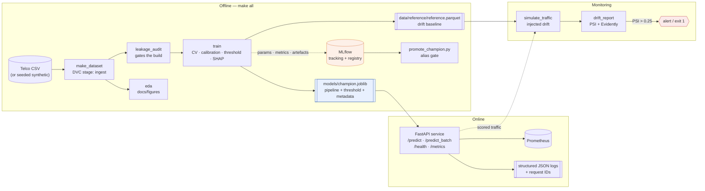
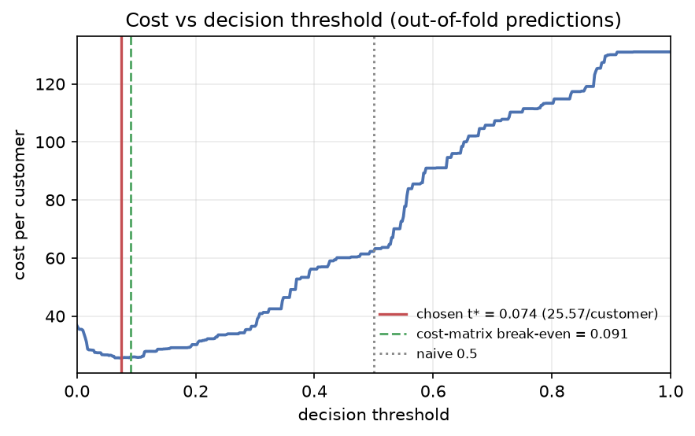
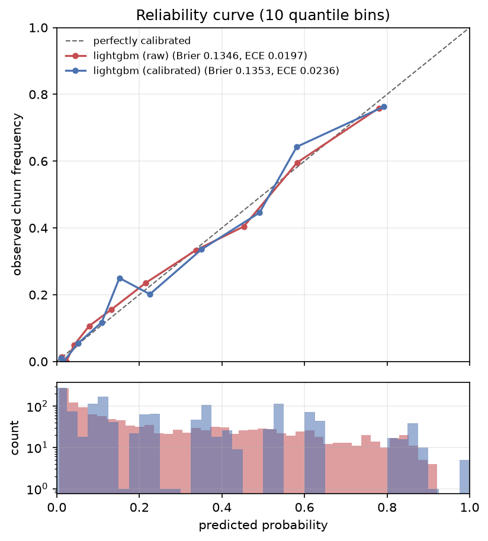
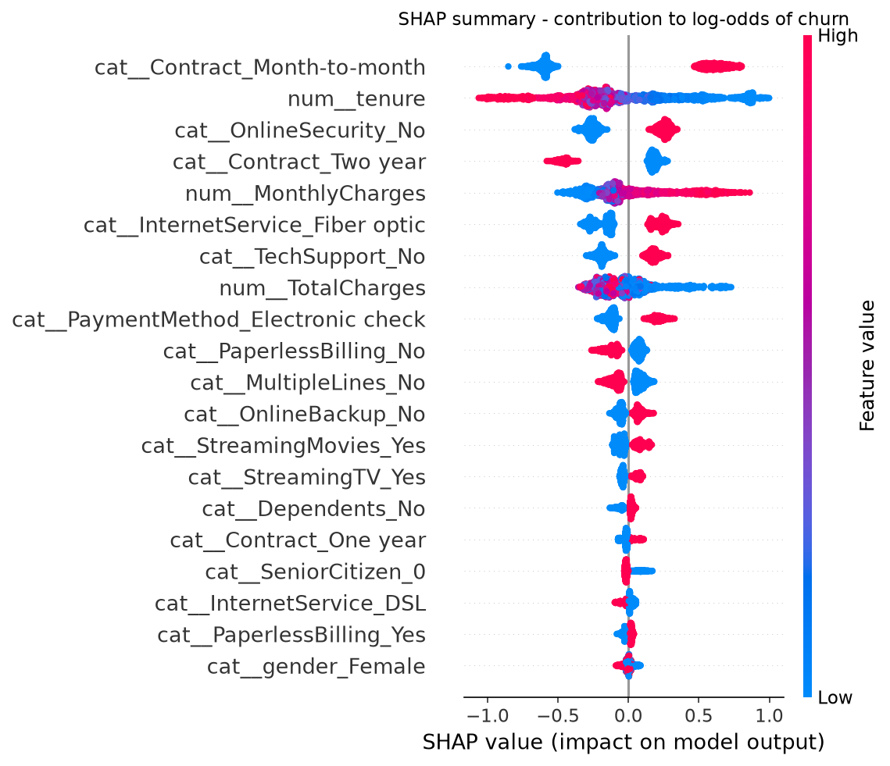
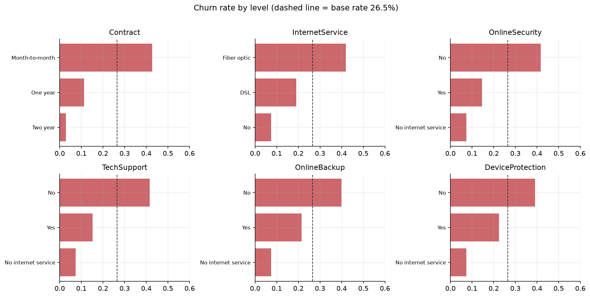
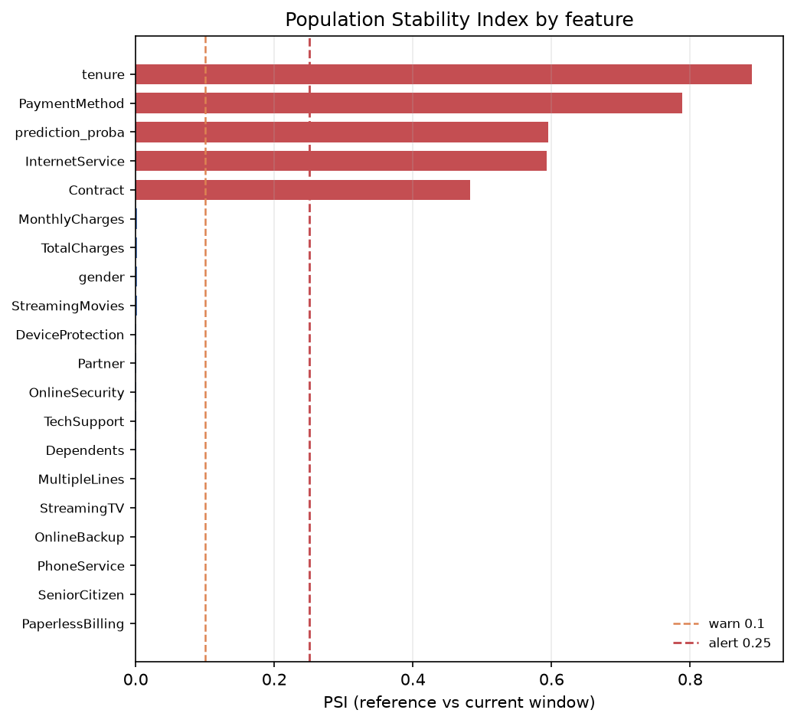

# mlops-churn-service

An end-to-end MLOps reference project: a deliberately simple churn model (LightGBM on
the IBM Telco Customer Churn dataset) wrapped in the engineering that makes a model a
service — reproducible pipeline, leakage audit, calibration, cost-based thresholding,
experiment tracking, a model registry with a promotion gate, a FastAPI service with
Prometheus metrics, containerisation, CI/CD, and drift monitoring with PSI alerting.

**The model is not the deliverable. The engineering around it is.**

Every number on this page was produced by the code in this repository on the real
7,043-row Telco dataset (seed 42); regenerate them with `make all`.

---

## Table of contents

1. [Architecture](#architecture)
2. [Quickstart](#quickstart)
3. [Business framing](#business-framing)
4. [Results](#results)
5. [Serving performance](#serving-performance)
6. [Drift monitoring](#drift-monitoring)
7. [Project layout](#project-layout)
8. [MLOps concepts, briefly](#mlops-concepts-briefly)
9. [SLOs](#slos)
10. [Limitations](#limitations)

---

## Architecture



---

## Quickstart

### 1. Install

```bash
python -m venv .venv
# Windows:        .venv\Scripts\activate
# macOS / Linux:  source .venv/bin/activate
python -m pip install --upgrade pip
pip install -e ".[dev,tracking,monitoring,loadtest]"
pre-commit install
```

### 2. Run the offline pipeline

```bash
python -m churn.data.make_dataset   --config configs/config.yaml   # download / generate
python -m churn.data.leakage_audit  --config configs/config.yaml   # exits 1 on a leak
python -m churn.data.eda            --config configs/config.yaml   # figures -> docs/figures
python -m churn.models.train        --config configs/config.yaml   # train + calibrate + threshold
```

…or `make all`. Everything is driven by `configs/config.yaml`; no parameter is hard-coded
in a script. Set `data.source: synthetic` to run with no network at all — the generator
reproduces the Telco schema, dtypes and the blank-`TotalCharges` quirk.

### 3. Serve

```bash
uvicorn churn.api.main:app --reload --port 8080
# http://localhost:8080/docs
curl -s localhost:8080/health | python -m json.tool
curl -s -X POST localhost:8080/predict -H 'Content-Type: application/json' \
     -d @tests/fixtures/sample_request.json | python -m json.tool
```

### 4. Full stack

```bash
docker compose up -d --build       # api :8080 · mlflow :5000 · postgres
docker compose --profile observability up -d   # + prometheus :9090
```

### 5. Test, lint, load, monitor

```bash
pytest                                                   # 80 tests
ruff check src tests && ruff format --check src tests
mypy
locust -f loadtest/locustfile.py --headless -u 50 -r 10 -t 1m --host http://localhost:8080
python -m churn.monitoring.simulate_traffic --scenario covariate --n 2000
python -m churn.monitoring.drift_report                  # exits 1 on a significant PSI
```

### 6. DVC (optional, one-time)

The pipeline definition in `dvc.yaml` is ready; initialise the repo and wire a remote:

```bash
dvc init
dvc remote add -d storage s3://your-bucket/churn   # or gdrive://, azure://, ssh://, local path
dvc repro            # runs ingest -> audit -> eda -> train, skipping unchanged stages
dvc metrics show     # reports/metrics.json
dvc dag
```

`dvc repro` hashes `configs/config.yaml` parameters per stage, so changing `costs.false_negative`
invalidates `train` but not `ingest`.

---

## Business framing

A churn model is only useful attached to an intervention. The one assumed here: a
retention offer, triggered when predicted churn probability crosses a threshold.

| Outcome | Meaning | Cost |
|---|---|---|
| False negative | Customer churns, no offer made | **500** (lost remaining margin) |
| False positive | Offer made to a customer who would have stayed | **50** (wasted discount) |
| True positive | Offer made to a churner | 0 (assumed to cancel the loss) |
| True negative | No offer, customer stays | 0 |

The 10:1 ratio is what makes 0.5 the wrong threshold. The break-even probability is

```
p* = C_FP / (C_FP + C_FN) = 50 / (50 + 500) = 0.0909
```

so you should intervene on anyone above ~9%, not 50%. The pipeline does not use that
closed form directly: it sweeps the threshold over **out-of-fold training predictions**
and takes the minimum-cost point (**0.074**, which lands close to the analytic 0.0909,
as it should once the model is calibrated). Selecting on out-of-fold predictions rather
than the test set is what keeps the reported test cost honest.



Change the costs in `configs/config.yaml` and the threshold moves with them — that is the
point of deriving it rather than picking it.

---

## Results

Dataset: IBM Telco Customer Churn, 7,043 rows, 26.5% positive. Stratified 80/20 holdout
(5,634 train / 1,409 test), seed 42. The dataset carries no event timestamp, so a random
stratified split is used and that assumption is stated rather than hidden; with a
timestamp, set `split.strategy: time`.

### Baselines and candidate — 5-fold CV on the training set

| Model | ROC-AUC | PR-AUC | Brier | Log loss |
|---|---|---|---|---|
| Majority class | 0.500 ± 0.000 | 0.265 ± 0.000 | 0.1949 | 0.5786 |
| Logistic regression | 0.846 ± 0.013 | 0.661 ± 0.019 | 0.1351 | 0.4167 |
| **LightGBM** | **0.849 ± 0.011** | **0.671 ± 0.021** | **0.1336** | **0.4119** |

The majority-class row is there to fix what "accuracy" means: it scores 73.5% accuracy
while catching zero churners. LightGBM beats the linear baseline by **0.003 AUC** — inside
one fold standard deviation. On this dataset that margin would not by itself justify a
gradient-boosted model in production; it is reported as measured rather than dressed up.

### Held-out test set (n = 1,409)

| | ROC-AUC | PR-AUC | Brier | Log loss | ECE |
|---|---|---|---|---|---|
| LightGBM, raw | 0.8484 | 0.6632 | 0.1346 | 0.4131 | 0.0197 |
| LightGBM, isotonic-calibrated | 0.8477 | 0.6416 | 0.1353 | 0.4151 | 0.0236 |

**Calibration did not help here, and the repository says so.** With the conservative
hyperparameters in `configs/config.yaml` (`num_leaves: 8`, `max_depth: 4`, `reg_lambda: 5`)
LightGBM's raw probabilities are already near-calibrated (ECE 0.0197), and isotonic
regression spends degrees of freedom to no benefit — Brier moves 0.1346 → 0.1353. The
calibration step is kept because it is the *mechanism* a cost-based threshold depends on,
and because an aggressively-tuned booster would need it; the honest reading of this table
is that it is insurance, not an improvement. Set `calibration.method: sigmoid` or raise
the tree capacity and the picture changes.



### Decision quality at the cost-optimal threshold

| Policy | Threshold | Precision | Recall | Alert rate | Cost / customer |
|---|---|---|---|---|---|
| Treat nobody | — | — | 0.000 | 0% | 132.72 |
| Naive 0.5 | 0.500 | 0.640 | 0.594 | 24.6% | 58.37 |
| Treat everybody | 0.000 | 0.265 | 1.000 | 100% | 36.73 |
| **Cost-optimal** | **0.074** | 0.355 | **0.981** | 73.4% | **26.15** |

Reading this table properly matters more than the headline:

* Against the naive 0.5 cut-off the cost-based threshold saves **32.22 per customer**
  (58.37 → 26.15), a 55% reduction. That is the result the project is built to produce.
* But note the fourth row: at a 10:1 cost ratio the optimum sits at a **73.4% alert rate** —
  close to "treat everybody", which on its own already costs only 36.73. The model's margin
  over blanket treatment is **10.57 per customer**, not 106. A cost matrix this lopsided
  makes the *ranking* worth less than the asymmetry.
* The realistic fix is a **capacity constraint**: a retention team that can call 500
  customers a week wants a top-K policy, not a probability threshold. That is a
  deliberate non-goal here and is listed under [Limitations](#limitations).

### Explainability



Month-to-month contract, short tenure, no online security, fibre-optic service and
electronic-cheque payment dominate — consistent with the EDA and with the published
analyses of this dataset, which is the weakest but most necessary form of validation:
the model has not learned something absurd.



### Leakage audit

`reports/leakage_audit.json`, regenerated on every `dvc repro` and every CI run:

| Check | Verdict | Evidence |
|---|---|---|
| Forbidden columns as features | PASS | `customerID`, `Churn` absent from the feature allow-list |
| Target association | PASS | max 0.410 (Cramér's V / point-biserial), ceiling 0.95 |
| Single-feature AUC | PASS | max 0.740, ceiling 0.99 |
| Duplicate entities | WARN | 0 duplicate ids; 22 duplicate *feature* rows (benign) |

A `FAIL` exits non-zero and breaks the build. The test suite plants a synthetic leak
(`retention_case_opened = Churn`) and asserts that both the association and single-feature
AUC checks catch it — monitoring code that has never seen the failure it looks for is
not tested.

---

## Serving performance

Measured on the included benchmark: 1,500 single-prediction requests plus 100 batches of
100, through the real ASGI application, single worker, 4-core development machine, after
a 100-request warm-up. **In-process transport** — no network hop — so treat these as a
floor for the service's own cost, not as end-to-end client latency.

| Path | p50 | p95 | p99 | Throughput |
|---|---|---|---|---|
| `POST /predict` (1 customer) | 40.6 ms | 57.6 ms | 61.1 ms | ~23 req/s per worker |
| `POST /predict_batch` (100 customers) | 42.9 ms | 53.5 ms | — | **2,334 rows/s** (0.43 ms/row) |

The 56× per-row gap between the two paths is the headline: request overhead, pydantic
validation and the `ColumnTransformer` dispatch dominate, while LightGBM inference itself
is ~1.8 ms. **Batch wherever the use case allows.**

One finding worth recording, because it cost the project 6× its latency budget:
`CalibratedClassifierCV` defaults to `ensemble=True`, which keeps `cv` separately-calibrated
copies of the model and runs **all of them** at predict time. Measured single-row latency
was **162 ms** with the default and **26 ms** with `ensemble=False` (one model, one
calibrator fitted on out-of-fold predictions). `configs/config.yaml` sets
`calibration.ensemble: false` and explains why.

Run the real load test against a running service for numbers that include the network:

```bash
docker compose up -d --build
locust -f loadtest/locustfile.py --headless -u 50 -r 10 -t 1m \
       --host http://localhost:8000 --csv reports/loadtest
```

The locustfile fails the run if p95 > 150 ms or the error rate exceeds 1%.

---

## Drift monitoring

PSI compares a live window against the training reference (`data/reference/reference.parquet`,
written by `train`). Bin edges are frozen from reference quantiles so successive days are
comparable. Bands follow the credit-scoring convention: `< 0.10` stable, `0.10–0.25`
moderate, `> 0.25` significant.

**PSI needs no labels.** Churn outcomes arrive weeks after the prediction, so
accuracy-based alerting is always late; an input or prediction distribution that has
moved is actionable today.

Verified in both directions — a detector that only ever fires is as useless as one that
never does:

| Scenario | Max feature PSI | Prediction PSI | Mean P(churn) | Status | Exit |
|---|---|---|---|---|---|
| `none` (resample reference) | 0.003 | 0.003 | 0.265 → 0.272 | OK | 0 |
| `covariate` (marketing push) | 0.889 (`tenure`) | 0.546 | 0.265 → 0.436 | **ALERT** | 1 |



Under the covariate scenario five signals breach the alert band — `tenure`,
`PaymentMethod`, `InternetService`, `Contract` and `prediction_proba` — exactly the
columns the simulator perturbs, plus the model's own output. The no-drift run stays two
orders of magnitude below the warn line, which is the false-positive check.

Four scenarios ship: `none`, `covariate`, `price`, and `concept` — the last changes the
input→label relationship while leaving marginals nearly intact, which input PSI largely
misses and only prediction PSI and realised labels catch. That blind spot is the reason
label-based evaluation cannot be dropped.

`drift_report` also writes an Evidently `DataDriftPreset` HTML report
(`reports/drift_report.html`) with per-feature KS and chi-square tests, and
`.github/workflows/drift-monitor.yml` runs the whole check on a daily schedule.

---

## Project layout

```
mlops-churn-service/
├── configs/
│   ├── config.yaml              # single source of truth for every stage
│   └── prometheus.yml
├── src/churn/
│   ├── config.py                # typed YAML access + shared --config flag
│   ├── logging_utils.py         # JSON logs + request-id ContextVar
│   ├── data/
│   │   ├── make_dataset.py      # download or generate, with a recorded provenance file
│   │   ├── leakage_audit.py     # 4 checks, exits 1 on FAIL
│   │   └── eda.py               # 3 figures -> docs/figures
│   ├── features/build_features.py   # ColumnTransformer inside a Pipeline
│   ├── models/
│   │   ├── baselines.py         # majority / logistic / lightgbm
│   │   ├── threshold.py         # CostMatrix + cost sweep
│   │   ├── evaluate.py          # metrics, ECE, reliability + cost + SHAP figures
│   │   ├── train.py             # the orchestration
│   │   └── promote_champion.py  # registry alias gate
│   ├── api/
│   │   ├── schemas.py           # pydantic v2, extra="forbid"
│   │   ├── model_registry.py    # bundle loader + degraded state
│   │   ├── metrics.py           # prometheus instruments
│   │   └── main.py              # app, middleware, endpoints
│   └── monitoring/
│       ├── psi.py               # PSI implementation
│       ├── simulate_traffic.py  # 4 drift scenarios
│       └── drift_report.py      # PSI + Evidently + alert logic
├── tests/                       # 80 tests: unit, integration, data contract
├── loadtest/locustfile.py
├── docs/
│   ├── model_card.md
│   ├── architecture.md
│   └── figures/
├── .github/workflows/           # ci.yml, drift-monitor.yml
├── dvc.yaml · Dockerfile · docker-compose.yml · Makefile · pyproject.toml
└── .vscode/                     # interpreter, pytest, debug configs, tasks
```

### Test suite — 80 tests

| File | Kind | Covers |
|---|---|---|
| `test_features.py` | unit | leak-free imputation, unknown categories, determinism, column-order invariance |
| `test_threshold.py` | unit | break-even algebra, cost accounting, grid optimality, tie-breaking |
| `test_data_contract.py` | contract | schema width, dtypes, ranges, missingness budget, category vocabulary, id uniqueness |
| `test_leakage_audit.py` | unit | clean data passes; a planted leak is caught |
| `test_psi.py` | unit | zero on identical, monotone in shift, finite on new levels, no false alarm on resampling |
| `test_api.py` | integration | all endpoints, 422 paths, headers, batch/single agreement, metrics exposition |
| `test_config.py` | unit | required sections, cost asymmetry, failure modes |

---

## MLOps concepts, briefly

**Why a `ColumnTransformer` inside a `Pipeline`, not manual transforms.** Impute or encode
a full DataFrame and *then* split, and the imputation median and category vocabulary have
seen the test rows. The leak is small, real, and invisible in the metrics. A Pipeline
guarantees `fit` only ever touches the training fold — inside every CV fold and inside the
calibration wrapper — and the artefact that ships is the whole Pipeline, so there is no
separate preprocessing script to keep in sync.

**Why calibration matters for a cost-based threshold.** Ranking quality (AUC) and
probability quality are different. A model can rank perfectly while reporting 0.9 for
cases that churn 40% of the time. The threshold derived from a cost matrix is a statement
*in probability units*: if the model's 0.09 does not mean "9 in 100 such customers churn",
the threshold is meaningless. Brier score and the reliability curve measure that; ECE
summarises it in one number.

**Why a registry, not just tracking.** Tracking answers "what did run `7f3a` do?". A
registry answers "what is in production right now, and what was there last Tuesday?" —
version numbers, aliases (`champion`, `challenger`), and an audit trail. Without one the
deployed artefact is whatever file happened to be on the box and a rollback is archaeology.
`promote_champion.py` only moves the `champion` alias if the challenger beats the incumbent
by `--min-delta` (default 0.002) and clears a Brier ceiling; a 0.001 AUC gain is noise and
every promotion costs a deployment.

**What PSI measures.** The symmetrised KL divergence of two discretised distributions:
`Σ (actual − expected) · ln(actual / expected)`. Unitless, label-free, and interpretable
against a convention everyone in credit risk already knows.

**Why the threshold travels with the model.** A threshold is only valid for the probability
distribution of the model it was tuned on. `models/champion.joblib` stores the pipeline,
the threshold and the metadata together, so a retrain cannot leave a service quietly
applying last month's cut-off.

---

## SLOs

| Objective | Target | Measured |
|---|---|---|
| `POST /predict` p95 latency | < 150 ms | 58 ms (in-process, single worker) |
| `POST /predict_batch` throughput | > 1,000 rows/s | 2,334 rows/s |
| Error rate under load | < 1% | enforced by `locustfile.py` |
| `/health` availability | 99.9% | degraded-not-dead when the bundle is missing |
| Model staleness | retrain ≤ 30 days | tracked by `trained_at` in `/health` |
| Max feature PSI | < 0.25 | daily check, exits 1 on breach |
| Cost per customer | ≤ 30 | 26.15 on the held-out set |

---

## Limitations

Stated plainly, because a reference project that hides its gaps teaches the wrong lesson.

1. **The gradient-boosted model barely beats the linear one** — 0.849 vs 0.846 CV ROC-AUC,
   inside one fold standard deviation. On this dataset, logistic regression is the
   defensible production choice; LightGBM is here because the project is about the
   surrounding engineering.
2. **Calibration measurably did not help** (Brier 0.1346 → 0.1353, ECE 0.0197 → 0.0236).
   Kept for the reason given above, not because it improved this model.
3. **No capacity constraint.** The cost-optimal threshold implies contacting 73.4% of the
   base. Any real retention team has a weekly call budget, which makes this a top-K
   ranking problem with a different objective. Not modelled.
4. **The cost matrix is invented.** 500 and 50 are plausible placeholders, not numbers from
   a finance team. Every downstream figure — the threshold, the savings, the SLO — inherits
   that assumption. Replace them before quoting any of it.
5. **No event timestamp, so no temporal validation.** The stratified split assumes a
   stationary churn process. The `time` strategy is implemented and untested on real data
   because this dataset cannot exercise it.
6. **True positives are assumed to cost nothing** — i.e. a retention offer always works.
   Real offers have an acceptance rate; a serious treatment of this needs uplift modelling
   (effect of the *offer*), not churn modelling.
7. **Drift windows are simulated, not observed.** `simulate_traffic.py` resamples the
   reference set and perturbs it. It validates the detector's mechanics and thresholds; it
   cannot validate them against real production drift.
8. **Concept drift is only partly detectable** by the shipped alerting. Input PSI largely
   misses it by construction; prediction PSI catches some of it. Label-based evaluation on
   a delay remains necessary and is not implemented here.
9. **Single-node everything.** No horizontal autoscaling, no canary or shadow deployment,
   no feature store, no online/offline consistency checks, no A/B harness, no authentication
   on the API. All are deliberate scope cuts.
10. **MLflow runs against local Postgres with filesystem artefacts.** Production needs
    object storage, backups and access control.

---

## Licence

MIT — see [LICENSE](LICENSE).
